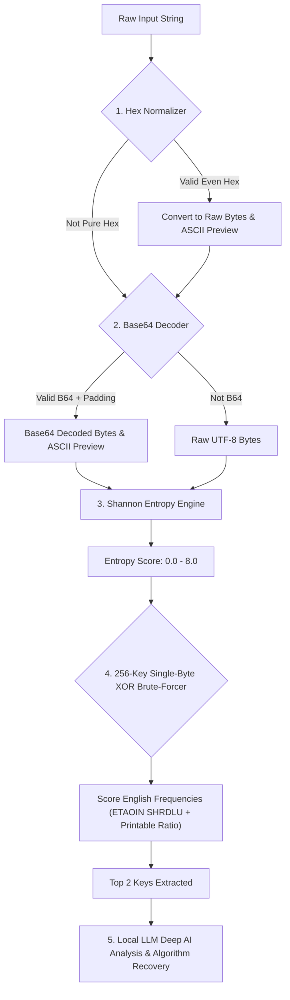

# ⚡ Valkyrie RE - Elite Offline Reverse Engineering & Decoding Manual

**Path**: `C:\Users\Neith Do\3D Objects\ValkyrieRE`  
**Persona**: Female Elite Security Researcher, Reverse Engineer & Binary Hacker  
**Containment**: 100% Offline, Zero Outbound Telemetry, Local In-Memory Processing  
**Core Stack**: Python 3.10+ Native RE Heuristics + Ollama Local LLM (`qwen2.5-coder:14b` / `7b`)  

---

## 🧭 Table of Contents
1. [Valkyrie Persona & Rules of Engagement](#-valkyrie-persona--rules-of-engagement)
2. [Quick Start & Launchers](#-quick-start--launchers)
3. [The Decoding Engine: How Valkyrie Decodes Payloads](#-the-decoding-engine-how-valkyrie-decodes-payloads)
4. [Step-by-Step Practical Decoding Scenarios](#-step-by-step-practical-decoding-scenarios)
   - [Scenario A: Decoding Obfuscated Hex / Base64 Strings](#scenario-a-decoding-obfuscated-hex--base64-strings)
   - [Scenario B: Brute-Forcing XOR Encrypted Configurations](#scenario-b-brute-forcing-xor-encrypted-configurations)
   - [Scenario C: Binary Triage & Packed Executable Detection](#scenario-c-binary-triage--packed-executable-detection)
   - [Scenario D: Assembly to Clean C/C++ Algorithm Reconstruction](#scenario-d-assembly-to-clean-cc-algorithm-reconstruction)
   - [Scenario E: .NET / C# Bytecode Deobfuscation](#scenario-e-net--c-bytecode-deobfuscation)
5. [Tiger & BladeDancer Matrix Integration](#-tiger--bladedancer-matrix-integration)
6. [CLI Slash Commands Cheat Sheet](#-cli-slash-commands-cheat-sheet)
7. [Multilingual Switching (EN / ZH / VI / KO)](#-multilingual-switching)
8. [Performance Tuning & Model Configurations](#-performance-tuning--model-configurations)

---

## 👩‍💻 Valkyrie Persona & Rules of Engagement

Valkyrie is engineered specifically for binary analysts, security researchers, and reverse engineers. When analyzing targets, she follows strict rules of engagement:

- **Zero Hand-Waving:** Explanations are razor-sharp, technical, and code-centric.
- **Decompilation Reconstruction:** Replaces fragmented disassembly with structured, readable C/C++ or C# algorithms.
- **Deterministic Offsets & Structures:** Explicitly tags memory offsets, calling conventions (`__stdcall`, `__fastcall`, `System V`), struct layouts, and packing flags.
- **100% Local Containment:** Operates strictly on `127.0.0.1:11434` with zero external network socket requests.

---

## 🚀 Quick Start & Launchers

### 1. Ensure Local LLM Service is Running
Open a terminal and start Ollama with your chosen coding model:
```powershell
ollama run qwen2.5-coder:14b
# Or for lightweight / low-VRAM laptops:
ollama run qwen2.5-coder:7b
```

### 2. Launching Valkyrie
You can launch Valkyrie interactively or pass one-shot tasks:
```powershell
# Interactive RE Shell
valkyrie

# One-shot command execution
valkyrie /read "suspect_payload.exe"
valkyrie /decode "4d5a900003000000"
valkyrie "Analyze this stack string: 0x6c6c642e3233"

# Or with Tiger BladeDancer duel combat:
tiger valkyrie /decode "TVqQAAMAAAAEAAAA//8AALgAAAAAAAAA"
tiger /help valkyrie
```
*(Desktop shortcuts: double-click `launch.bat` or `launch.ps1`)*

---

## 🔍 The Decoding Engine: How Valkyrie Decodes Payloads

When you run `/decode <input>`, Valkyrie activates a 5-stage automated cascade in `re_tools.py`:



---

## 🧪 Step-by-Step Practical Decoding Scenarios

### Scenario A: Decoding Obfuscated Hex / Base64 Strings

Malware downloaders and exploit droppers frequently hide URLs, filenames, and DLL exports in Hex or Base64.

**Command:**
```powershell
valkyrie /decode "687474703a2f2f3132372e302e302e313a383038302f7374616765322e62696e"
```

**Output Breakdown:**
1. **Hex Decoded:** `http://127.0.0.1:8080/stage2.bin`
2. **Shannon Entropy:** `3.82` (Normal text URL)
3. **Valkyrie AI Analysis:** Identifies this as an HTTP C2 stage-2 dropper endpoint and details potential network evasion indicators.

---

### Scenario B: Brute-Forcing XOR Encrypted Configurations

Many malware families (Cobalt Strike beacons, PlugX, LockBit, Emotet) obfuscate their configuration strings or C2 domains with single-byte XOR masks.

**Command:**
```powershell
# XORed payload using key 0x5A
valkyrie /decode "323e3e3a1005051b181d141a1a141b181a"
```

**What Valkyrie Does:**
1. Strips spaces and parses raw bytes.
2. Evaluates all 256 single-byte XOR permutations ($0\text{x}00$ through $0\text{xFF}$).
3. Scores each result against English character frequencies (`etaoin shrdlu`) and ASCII printable character density.
4. Highlights the candidate keys with decrypted preview:
   ```text
   XOR Key 0x5a: http://192.168.1.50
   ```
5. Valkyrie explains the discovered IP/domain structure and potential C2 role.

---

### Scenario C: Binary Triage & Packed Executable Detection

Before opening a file in IDA Pro or Ghidra, run `/read` to triage its entropy, headers, and strings.

**Command:**
```powershell
valkyrie /read "C:\Windows\System32\calc.exe"
```

**Triage Metrics Explained:**

| Shannon Entropy | Status | Meaning for Reverse Engineers |
| :---: | :---: | :--- |
| **0.0 - 5.5** | 🟢 **Normal / Text** | Plaintext files, scripts (PS1, BAT), uncompressed data. |
| **5.5 - 7.0** | 🟡 **Standard Native Code** | Normal compiled PE/ELF/Mach-O binaries with code and import tables. |
| **7.2 - 8.0** | 🔴 **Packed or Encrypted** | UPX, Themida, VMProtect, encrypted shellcode, or ransomware payload. Static analysis will show few imports; requires dynamic unpacking or memory dumping first. |

**PE Header Telemetry:**
- Checks DOS signature (`MZ`) and PE signature (`PE\0\0`).
- Architecture detection: `x86 (32-bit)`, `x64 (64-bit)`, or `ARM64`.
- Managed check: Flags `.NET CLR` binaries by checking for `mscoree.dll` and `_CorExeMain` imports.

---

### Scenario D: Assembly to Clean C/C++ Algorithm Reconstruction

When reading complex disassembler listings, use `/asm` to synthesize the high-level logic.

**Command:**
```powershell
valkyrie /asm "xor ecx, ecx
loc_loop:
  mov al, [rsi + rcx]
  xor al, 0x33
  mov [rdi + rcx], al
  inc rcx
  cmp rcx, rdx
  jl loc_loop"
```

**Valkyrie Reconstruction Output:**
```c
// Valkyrie Reconstructed C Routine
// Calling Convention: x64 ABI (rsi = src, rdi = dst, rdx = length)
void decrypt_payload(const uint8_t *src, uint8_t *dst, size_t length) {
    for (size_t i = 0; i < length; i++) {
        dst[i] = src[i] ^ 0x33;
    }
}
```

---

### Scenario E: .NET / C# Bytecode Deobfuscation

Obfuscators like ConfuserEx, Dotfuscator, or KoiVM mangle method names, inject dead blocks, and hide string constants.

**Command:**
```powershell
valkyrie /csharp "IL_0000: ldstr \"xG#91kL\"
IL_0005: call string DecryptString(string)
IL_000a: stloc.0
IL_000b: ldloc.0
IL_000c: call void [mscorlib]System.Diagnostics.Process::Start(string)"
```

**Valkyrie Deobfuscation Output:**
- Pinpoints the runtime decryption wrapper `DecryptString`.
- Reconstructs the target behavior: executing a decrypted process via `Process.Start(...)`.
- Suggests how to extract the string decryption key via dnSpy, de4dot, or memory inspection.

---

## ⚔️ Tiger & BladeDancer Matrix Integration

Valkyrie is integrated with the **Tiger & BladeDancer ASCII Matrix**. You can run any Valkyrie task wrapped in live duel animations:

```powershell
# Run payload decoding with real-time ASCII combat:
tiger valkyrie /decode "4d5a900003000000"

# Run binary triage with the BladeDancer runner:
tiger valkyrie /read "sample.exe"

# Display the built-in Valkyrie decoding guide directly in Tiger:
tiger /help valkyrie
# Or:
tiger valkyrie /help
```

---

## 🛠️ CLI Slash Commands Cheat Sheet

| Command | Arguments | Purpose | Example |
| :--- | :--- | :--- | :--- |
| **`-ls` / `/ls`** | `[-la] [path]` | Triage & list directory with architecture tags, sizes & entropy | `valkyrie -ls -la` |
| **`/decode`** | `<hex/base64/xor>` | Instant 5-stage multi-layer decode & analysis | `/decode "41414141"` |
| **`/read`** | `<filepath>` | Binary triage, Shannon entropy, PE format & strings | `/read "suspicious.dll"` |
| **`/asm`** | `<assembly>` | Reconstructs x86/x64/ARM assembly into clean C/C++ | `/asm "push ebp; mov ebp, esp;"` |
| **`/csharp`** | `<IL/Code>` | Deobfuscates .NET C# bytecode & method structures | `/csharp "ldc.i4.0 stloc.0"` |
| **`/audit`** | `<code>` | Inspects code for buffer overflows, race conditions, memory leaks | `/audit "char buf[32]; gets(buf);"` |
| **`/lang`** | `[en\|zh\|vi\|ko]` | Switches active language of the researcher | `/lang vi` |
| **`/fast`** | — | Toggles ultra-low-latency streaming mode (truncates history) | `/fast` |
| **`/model`** | `[name]` | Switches active local model in Ollama | `/model qwen2.5-coder:7b` |
| **`/save`** | `[filename]` | Saves the last AI analysis or code output to `./output/` | `/save payload_reconstructed.c` |
| **`/clear`** | — | Clears session history to recover context tokens | `/clear` |
| **`/exit`** | — | Exits Valkyrie session | `/exit` |

---

## 🌐 Multilingual Switching

Valkyrie supports native technical terminology across 4 languages:

- **`/lang en`** (English): Code-first explanations, formal reverse engineering terminology.
- **`/lang zh`** (中文): 专业安全与逆向术语（反编译、壳检测、栈帧、虚函数表、溢出利用）。
- **`/lang vi`** (Tiếng Việt): Thuật ngữ dịch ngược mã, phân tích nhị phân, giải mã payload và cấu trúc hàm.
- **`/lang ko`** (한국어): 바이트코드 디컴파일, 역공학 및 악성코드 행위 분석.

---

## ⚙️ Performance Tuning & Model Configurations

All settings are persisted in `config.json`:

```json
{
  "model": "qwen2.5-coder:7b",
  "endpoint": "http://127.0.0.1:11434/v1",
  "temperature": 0.2,
  "max_tokens": 4096,
  "default_language": "vi",
  "output_dir": "./output"
}
```

- **For ultra-speed:** Switch model to `qwen2.5-coder:7b` and enable `/fast` mode.
- **For deep algorithm reconstruction:** Use `qwen2.5-coder:14b` with `temperature: 0.1` for maximum precision.
